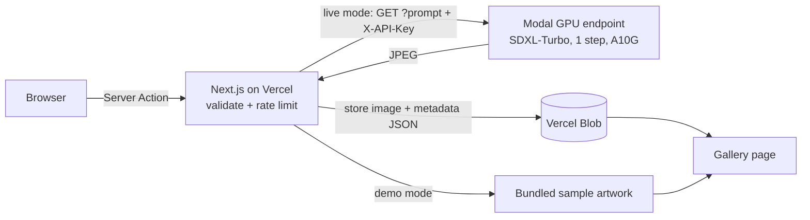

# Pentagram

**Instagram, but every picture is generated from a text prompt. Stable Diffusion (SDXL-Turbo) on Modal serverless GPUs, a Next.js app on Vercel, and a persistent gallery.**

<!-- TODO(Hewan): record a short GIF (type a prompt -> image appears -> gallery),
     save it as docs/demo.gif and uncomment the next line.
 -->

[](https://github.com/hewansirak/Pentagram/actions)


**Live demo:** _add your Vercel URL here after deploying (see [Deploy](#deploy))_

## Two modes

| | Demo mode (default) | Live mode |
|---|---|---|
| Needs | nothing | Modal endpoint + Vercel Blob |
| Generating | matches your prompt to one of 6 bundled sample artworks | real SDXL-Turbo image from a GPU |
| Gallery | the 6 samples | every image generated, newest first |

The app switches to live mode automatically when `MODAL_URL`, `API_KEY` and `BLOB_READ_WRITE_TOKEN` are all set. In demo mode a banner says so; sample artwork is never presented as AI output.

## Features

- Prompt → image with one click, plus example prompt chips.
- Gallery of all generated images (stored in Vercel Blob, no database needed).
- Prompt validation (length limit, small blocklist for obviously unsafe terms – a basic guard, not a full safety system).
- Per-IP rate limit (5/min, in-memory per server instance) to protect GPU spend.
- Image API protected by a secret key, compared in constant time.
- Server-side only secrets: the browser never sees the Modal URL or key.

## Architecture



## Tech stack

Next.js 15 (App Router, Server Actions), React 19, TypeScript, Tailwind CSS, Vercel Blob, Modal, Stability AI SDXL-Turbo via Hugging Face Diffusers, Vitest, GitHub Actions.

## Quick start (demo mode)

```bash
git clone https://github.com/hewansirak/Pentagram && cd Pentagram
npm install
npm run dev          # http://localhost:3000
npm test
```

## Run it live

1. **GPU backend**
   ```bash
   pip install modal && modal setup
   modal secret create API_KEY API_KEY=<long-random-string>
   modal deploy Modal_config/main.py
   ```
   Copy the `generate` URL that Modal prints.
2. **Environment** – copy `.env.example` to `.env.local` and fill in `MODAL_URL`, `API_KEY` (same value as the Modal secret) and `BLOB_READ_WRITE_TOKEN` (Vercel → Storage → Blob).
3. `npm run dev`. The demo banner disappears when live mode is active.

**Cost note:** `KEEP_WARM=1 modal deploy ...` pings the model every 5 minutes so there are no cold starts, but that keeps an A10G GPU running around the clock. It is off by default.

## Deploy

1. Import the repo in [Vercel](https://vercel.com/new) and add a Blob store (Storage tab).
2. Add `MODAL_URL` and `API_KEY` under *Environment Variables* (Blob adds its own token). Skip them to deploy the demo mode.
3. Put the resulting URL at the top of this README.

## Roadmap

- [ ] Authentication and per-user profiles
- [ ] Likes, comments and sharing
- [ ] Semantic search over prompts (embeddings)
- [ ] Personalised feed (recommendations)
- [ ] Persistent rate limiting (Upstash Redis) and a real moderation model

## Credits

Started from the [Pentagram starter](https://github.com/team-headstart/pentagram) by Headstarter (team-headstart). The Modal backend, image storage, gallery, demo mode, validation and tests were built by Hewan Sirak.

## License

MIT
